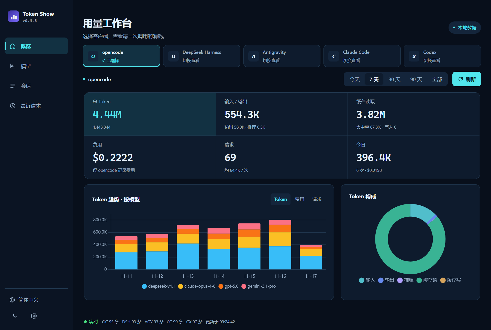
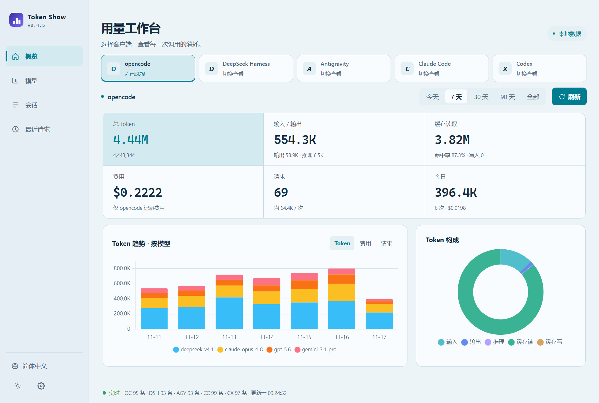
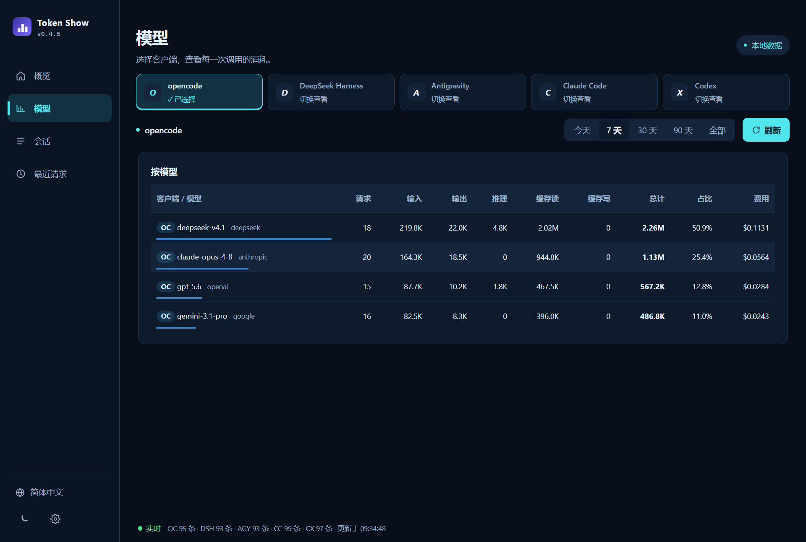

<div align="center">


# Token Show

**本地优先的 AI 编程工具用量仪表盘**

opencode · DeepSeek Harness · Antigravity · Claude Code · Codex

[](https://github.com/shangxinxiaolin/Token-Show/releases)
[](https://www.electronjs.org/)
[](LICENSE)
[](https://github.com/shangxinxiaolin/Token-Show/releases)

[功能](#功能) · [界面预览](#界面预览) · [数据源](#支持的数据源) · [下载](#下载) · [构建](#构建) · [隐私](#隐私)

</div>



> 截图使用内置演示数据，不含真实会话、路径或用量。

## 功能

| 能力 | 说明 |
| --- | --- |
| **五端聚合** | 自动检测 opencode、DeepSeek Harness、Antigravity、Claude Code、Codex 的本地日志。 |
| **客户端单选** | 顶部一键切换客户端，概览、趋势、模型、会话与最近请求同步联动。 |
| **按模型拆解** | 趋势图按模型堆叠，同一根柱子分段显示各模型的 Token、费用或请求量；展示 Top 5，其余归入「其他模型」。 |
| **用量全貌** | 总 Token、输入/输出/推理、缓存读写与命中率、费用、请求数、今日用量。 |
| **多维明细** | 按模型、按会话（Top 50）、最近请求，支持时间范围：今天 / 7 天 / 30 天 / 90 天 / 全部。 |
| **本地优先** | 只读本机日志，不联网、不上传、不同步账号历史；路径可自动检测或手动指定。 |
| **桌面体验** | 自动刷新、系统托盘、窗口置顶、关闭到托盘、一体化标题栏。 |
| **双语与主题** | 简体中文 / English，深色与浅色主题。 |

## 界面预览

| 浅色主题 | 模型明细 |
| --- | --- |
|  |  |

## 支持的数据源

| 客户端 | 默认位置 | 环境变量 |
| --- | --- | --- |
| opencode | `~/.local/share/opencode/opencode.db` | — |
| DeepSeek Harness | `~/.dsh` | `DSH_HOME` |
| Antigravity | `~/.gemini/antigravity-cli` | — |
| Claude Code | `~/.claude/projects` | `CLAUDE_CONFIG_DIR` |
| Codex | `~/.codex`（含 `sessions`、`archived_sessions`） | `CODEX_HOME` |

> WSL、Docker、远程服务器或其它 Windows 用户下的数据，需要在设置中指定可访问路径。

## 下载

Windows 安装版与免安装版发布在 **[GitHub Releases](https://github.com/shangxinxiaolin/Token-Show/releases)**。

| 版本 | 文件 | 说明 |
| --- | --- | --- |
| 安装版 | `Token Show Setup 0.4.5.exe` | 可选安装目录，创建开始菜单与卸载项 |
| 免安装版 | `Token Show 0.4.5.exe` | 单文件运行，不写安装目录 |

## 构建

需要 Node.js 20+ 与 Windows x64。

```powershell
npm install
npm start        # 开发运行
npm run dist     # 生成安装版 + 免安装版
```

打包输出到 `release/<版本号>/`。构建产物不纳入仓库，可单独上传到 GitHub Releases。

界面截图或开发时可启用演示数据，不会读取任何本地日志：

```powershell
$env:TOKEN_SHOW_DEMO='1'; npm start
```

## 测试

```powershell
node scripts/test_aggregate.js

$env:ELECTRON_RUN_AS_NODE='1'
node_modules\electron\dist\electron.exe scripts/test_dsh.js
node_modules\electron\dist\electron.exe scripts/test_new_providers.js
```

覆盖：按模型分段的聚合一致性、DSH 多帧 Zstandard 与日志追加检测、Claude 流式去重、Codex 累计差分。

## 隐私

> **数据留在你的电脑上。** 应用不包含遥测、统计上报或账号同步，也不会访问网络。

- 设置保存在本机 `%APPDATA%\Token Show\config.json`。
- 仅解析用量、模型、时间等元数据，不展示对话正文。
- 仓库不包含会话日志、数据库、本机绝对路径、账号凭据或构建产物。

## 费用说明

只有 **opencode** 的日志包含单次费用记录。DeepSeek Harness、Claude Code、Codex 的费用显示为 0，表示**未记录账单**，不代表免费使用。

Claude Code 流式消息按消息 ID 去重；Codex 的累计用量按增量计算；缓存读写与推理 Token 不会重复计入总量。

## 项目结构

```text
src/
  main.js               主进程：窗口、托盘、刷新、IPC
  preload.js            安全桥接
  aggregate.js          时间范围与模型/会话聚合
  providers/            各客户端日志读取
  renderer/             界面（HTML/CSS/JS + Chart.js）
scripts/                打包与回归测试
assets/icon.png         应用图标
design-system/          界面设计记录
```

<details>
<summary><b>版本记录</b></summary>

- **0.4.5**：趋势图按模型堆叠；同名模型附服务商后缀；修复启动阶段切换客户端的响应竞态。
- **0.4.4**：修复快速切换后图表空白（Chart.js 动画竞态）；无费用/无用量时显示说明。
- **0.4.3**：费用趋势按实际金额自动缩放。
- **0.4.2**：客户端改为单选；重绘「用量工作台」界面。
- **0.4.1**：修复 DSH 自动刷新漏检。
- **0.4.0**：新增 Claude Code、Codex 支持。
- **0.3.0**：多客户端聚合与一体化窗口。

</details>

<div align="center"><sub>MIT License · 数据留在你的电脑上</sub></div>
